<div align="center">

# Decklume — AI presentation maker for Claude Code

**Turn any topic, notes or PowerPoint into a stunning, animated HTML presentation.**<br>
Story-first outlines · your slides in three styles side by side · 13 designer themes · Magic Move transitions · presenter view · vector PDF · automated design QA.

[](https://github.com/GgauravJ05/decklume/actions/workflows/ci.yml)
[](LICENSE)
[](#install)
[](#themes)
[](#what-you-get)

[**Live demos**](https://ggauravj05.github.io/decklume/) · [Install](#install) · [Themes](#themes) · [How it works](#how-it-works) · [FAQ](#faq)

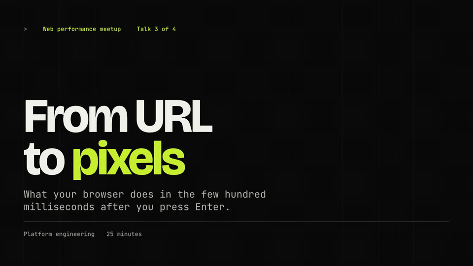

</div>

---

Most AI-made slides look the same: a heading, three bullets, a purple gradient.
**Decklume** is a [Claude Code](https://claude.com/claude-code) skill that gives
Claude a real design system instead of adjectives. It has a fixed 16:9 canvas, a
modular type scale, a 12-column grid, 26 tested slide layouts and thirteen complete
themes. A **QA gate** renders every slide in a real browser and fails the deck on
overflow, overlap, low contrast or tiny text before you ever see it.

It's built for **students, teachers, researchers and founders**: lectures,
thesis defenses, class projects, case competitions, hackathon demos, pitch decks
and conference talks.

> *"Make a 15-minute lecture on how sleep shapes memory for first-year psychology students."*
>
> The result is [this 29-slide deck](https://ggauravj05.github.io/decklume/demos/folio.html):
> press → to step through it, `P` for the presenter view, `O` for the overview.

> [!NOTE]
> Decklume is actively developed and **more features are coming soon**. See the [roadmap](#roadmap), and tell us what you'd like next.

## Contents

- [What you get](#what-you-get)
- [Example decks](#example-decks)
- [Animations and transitions](#animations-and-transitions)
- [Install](#install)
- [How it works](#how-it-works)
- [Themes](#themes)
- [Layouts](#layouts)
- [Presenting](#presenting)
- [Command-line tools](#command-line-tools)
- [Decklume vs. other slide skills](#decklume-vs-other-slide-skills)
- [FAQ](#faq)
- [Roadmap](#roadmap)
- [Contributing](#contributing)

## What you get

| | |
|---|---|
| **Story first** | Claude writes a slide-by-slide outline with an *assertion headline* on every slide ("Half the night is stage N2", not "Sleep stages"). You approve it before any design happens. |
| **Show, don't ask** | Your own title and content slides, rendered in three themes on **one comparison page**. Pick A, B, C, or mix them. |
| **13 designer themes** | Editorial, cinematic, Swiss, academic, consulting, product launch, brutalist, Japanese minimal, playful, chalkboard, engineering blueprint, newspaper and clinical. Each is complete across every layout. |
| **26 tested layouts** | Title, section, statement, quote, cards, split, full-bleed, compare, timeline, steps, KPI, stats, chart, table, code, diagram, people, agenda, definition, gallery, closing, 2×2 matrix, pricing tiers, roadmap, problem → solution and free-form. |
| **Magic Move** | Elements glide between slides (Keynote-style) using the View Transitions API. Pair them by hand, or let auto Magic Move match titles, numbers and images. |
| **Animation library** | 10 slide transitions, 13 entrance effects (typewriter, count-up, SVG draw…), step builds with highlight sweeps, and line-by-line code walkthroughs. |
| **Charts without libraries** | Bar, horizontal bar, line and donut charts from data attributes, coloured by the theme, highlighting the point your headline makes. |
| **Automated design QA** | Overflow, clipped text, overlap, type size, WCAG contrast, font loading, leaked placeholder text, broken images, 16:9 on phones, AI-slop patterns, plus a contact sheet of every slide. |
| **Presenter view** | Notes, timer, clock and next slide in a second window, synced live. Also overview grid, jump-to-slide, blackout and fullscreen. |
| **Edit in the browser** | Press `E`, click any text, `⌘/Ctrl+S` saves a clean HTML file. |
| **Share anywhere** | A single self-contained HTML file, a **vector PDF with selectable text** (a 29-slide deck is about 0.9 MB), PNG per slide, or a live link. |
| **PowerPoint import** | Reads `.pptx`, including bullet levels, tables, images in groups, speaker notes and **native chart data**. |

## Example decks

Four complete decks, each made for a different room. Open one and use the arrow keys; press `P` for the presenter view.

| Deck | For | Theme | What it shows |
|---|---|---|---|
| [How Sleep Shapes Memory](https://ggauravj05.github.io/decklume/examples/sleep-and-memory.html) | Students and teachers | Folio | All 26 layouts, builds, Magic Move, speaker notes |
| [From URL to Pixels](https://ggauravj05.github.io/decklume/examples/url-to-pixels.html) | Engineers | Volt | Push/wipe/flip/iris transitions, a self-drawing diagram, code walkthroughs |
| [Does Retrieval Practice Beat Rereading?](https://ggauravj05.github.io/decklume/examples/retrieval-practice-defense.html) | Researchers | Campus | A thesis defense with a MathML formula, count-up and highlight builds (fictional study, labelled) |
| [Orbit Notes: Seed Pitch](https://ggauravj05.github.io/decklume/examples/orbit-notes-pitch.html) | Founders | Aurora | Auto Magic Move carrying a traction number between slides (fictional company, labelled) |

Sources live in [`examples/`](examples/); every deck passes the design QA gate.

## Animations and transitions

Motion is declared in plain HTML and choreographed by the engine. The full guide is in
[`references/motion.md`](skills/decklume/references/motion.md).

```html
---
transition: push            # deck default: fade, push, rise, cover, zoom, wipe, iris, blur, flip, morph, none
---
<section class="slide l-kpi" data-transition="iris">
  <p class="big-number num" data-anim="count">1,250<span class="unit">ms</span></p>
</section>

<li class="step" data-anim="highlight">The phrase that matters</li>

<pre class="code" data-lines="1-3|5|7-9"><code>…</code></pre>   <!-- one range per press -->
```

| | |
|---|---|
| **Slide transitions** | fade · push · rise · cover · zoom · wipe · iris · blur · flip · morph · none, reversed automatically when going back |
| **Entrances** | fade · rise · drop · left · right · scale · pop · blur · wipe · iris · flip · type (typewriter) · count (count-up) · draw (SVG strokes) |
| **Builds** | any entrance on a `.step`, plus `highlight`; `data-dim` dims earlier points |
| **Code** | `data-lines` walkthroughs focus one range of lines per press |
| **Always safe** | reduced motion is respected; PDF, PNG and QA always show the finished slide |

## Install

### As a Claude Code plugin (recommended)

Run these one at a time inside Claude Code:

```text
/plugin marketplace add https://github.com/GgauravJ05/decklume
```

```text
/plugin install decklume@decklume
```

Then ask for a presentation, or call it directly with `/decklume:decklume`.

### As a standalone skill

```bash
git clone https://github.com/GgauravJ05/decklume.git
cp -R decklume/skills/decklume ~/.claude/skills/
```

Then use `/decklume`, or just ask Claude for a presentation.

**Requirements:** Node.js 18+. Design QA, style previews and PDF export use
Playwright, which installs itself once into `~/.cache/decklume` (never into your
project). Everything else, including PowerPoint import, needs only Node.

### Other coding agents

The skill is plain Markdown plus Node scripts. Point any agent with file and
shell access at [`skills/decklume/SKILL.md`](skills/decklume/SKILL.md).

## How it works

```
 Brief ──▶ Storyline ──▶ Style discovery ──▶ Build ──▶ QA gate ──▶ Deliver
  1 round    you approve    3 themes, your      single    must pass,    PDF · PNG ·
  of Qs      the outline    own slides          HTML      contact sheet  live link
```

1. **Brief.** One round of questions: purpose, audience, speaker-led or
   reading deck, length, assets.
2. **Storyline.** An outline table: layout, assertion headline and content
   for every slide, paced for the talk's length.
3. **Style discovery.** Claude writes your title slide and two key content
   slides once, and `preview.mjs` renders them in three contrasting themes side
   by side. You can also ask for a custom theme designed for your brand.
4. **Build.** Claude writes only slide *content* using layout classes;
   `build.mjs` inlines the engine, theme and fonts into one HTML file.
5. **QA gate.** `qa.mjs` renders every slide and must pass with zero errors.
   Claude then reviews the contact sheet like a designer.
6. **Deliver.** It opens the deck and offers PDF, PNG or a live link.

Prompts that work well:

```text
Make a 10-minute thesis defense deck from my abstract and results in ./thesis.md
Turn lecture-04.pptx into a Chalk-themed deck and keep my speaker notes
Pitch deck for our hackathon project — dark, techy, 8 slides, end with the demo link
Case competition deck from this analysis, consulting style, numbered exhibits
Explain the French Revolution to 10th graders in 15 slides, playful but clear
```

## Themes

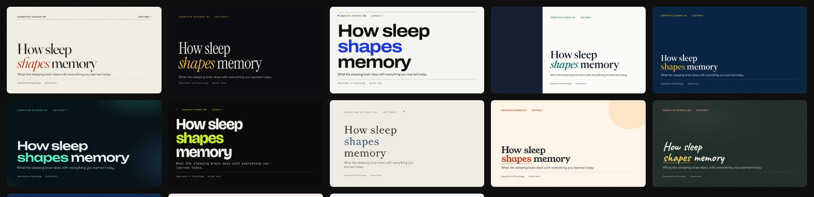

Every theme is complete across all 26 layouts and passes the same QA.
[**Open the live demos →**](https://ggauravj05.github.io/decklume/#themes)

| Theme | Best for | Preview |
|---|---|---|
| **Folio**: editorial serif on warm paper | keynotes, humanities, thesis defenses | 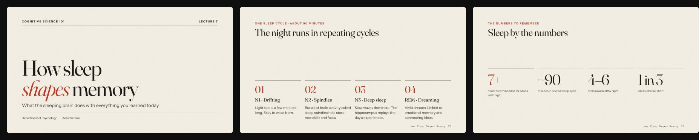 |
| **Nocturne**: dark cinematic | conference keynotes, storytelling | 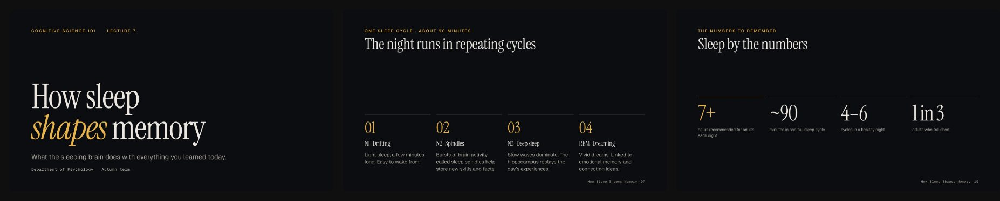 |
| **Grid**: Swiss International Style | business reviews, design talks, pitches | 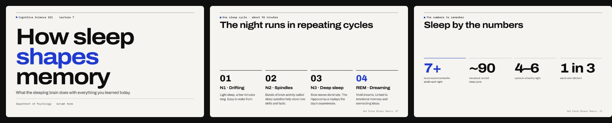 |
| **Campus**: academic, reading-first | lectures, seminars, study guides | 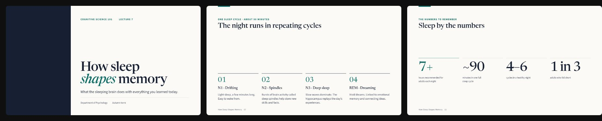 |
| **Atlas**: consulting, numbered exhibits | case competitions, strategy, finance | 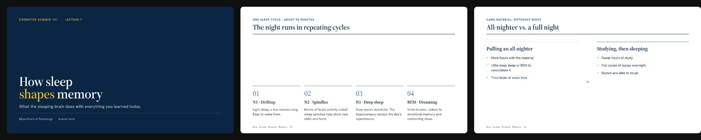 |
| **Aurora**: product-launch glow | launches, demo days, AI announcements | 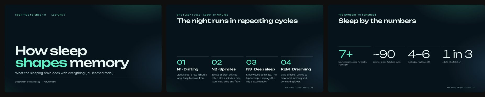 |
| **Volt**: brutalist terminal | dev talks, hackathons, open source | 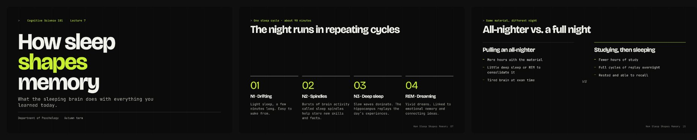 |
| **Ma**: Japanese minimal | design, architecture, philosophy | 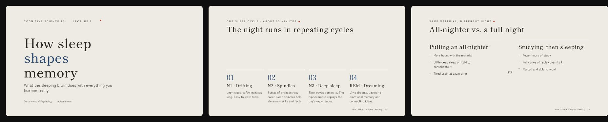 |
| **Bloom**: warm and playful | workshops, school and club talks | 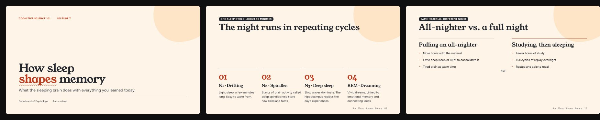 |
| **Chalk**: classroom blackboard | lessons, tutoring, maths and science | 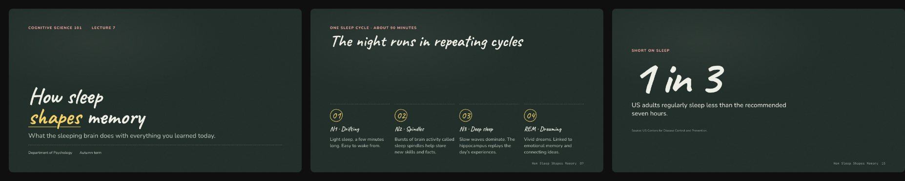 |
| **Blueprint**: engineering drawing | system design, architecture, STEM | 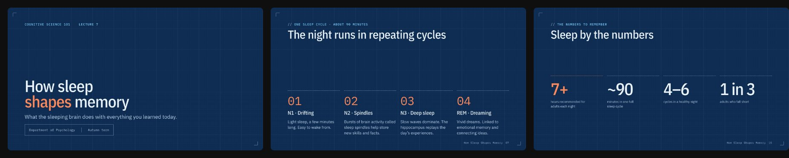 |
| **Broadsheet**: newspaper front page | reports, policy, journalism, history | 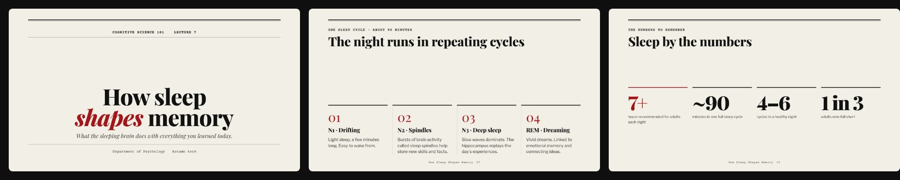 |
| **Clinic**: clean and reassuring | healthcare, public health, life sciences | 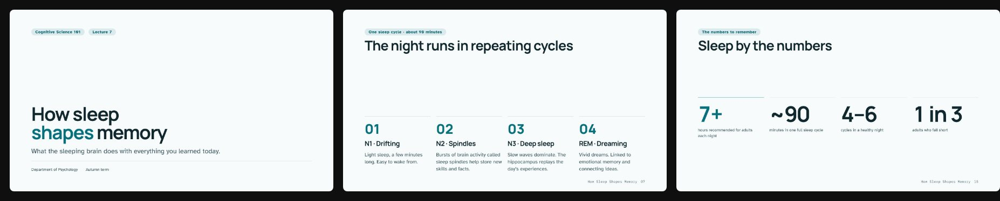 |

Need something else? Claude can design a **custom theme** for your brand or
subject. See [`references/custom-themes.md`](skills/decklume/references/custom-themes.md).

## Layouts

Slides are written as semantic HTML with one layout class each. The engine does
the rest:

```html
<section class="slide l-kpi">
  <p class="eyebrow">Short on sleep</p>
  <p class="big-number num" data-morph="stat">1 in 3</p>
  <p class="lead">US adults regularly sleep less than the recommended seven hours.</p>
  <p class="source">Source: US Centers for Disease Control and Prevention.</p>
</section>
```

`l-title` · `l-section` · `l-statement` · `l-quote` · `l-list` · `l-cards` ·
`l-split` · `l-bleed` · `l-compare` · `l-timeline` · `l-steps` · `l-kpi` ·
`l-stats` · `l-chart` · `l-table` · `l-code` · `l-diagram` · `l-people` ·
`l-agenda` · `l-define` · `l-gallery` · `l-closing` · `l-free`

Each layout's markup and content limits are in
[`references/layouts.md`](skills/decklume/references/layouts.md).

## Presenting

| Key | Action |
|---|---|
| `→` `Space` / `←` | Next step or slide / back |
| `O` | Overview grid (click to jump) |
| `P` | Presenter window: notes, timer, next slide |
| `12` `Enter` | Jump to slide 12 |
| `F` · `B` | Fullscreen · blackout |
| `E` then `⌘/Ctrl+S` | Edit text in the browser, save the file |
| `G` | Show the 12-column grid overlay |
| `?` | All shortcuts |

Swipe works on phones and tablets, and the slide always stays 16:9.

## Command-line tools

Everything Claude runs, you can run too. Node 18+, no install step.

```bash
S=skills/decklume/scripts

node $S/build.mjs talk.deck.html                 # → talk.html (one self-contained file)
node $S/build.mjs talk.deck.html --theme grid --inline-assets --watch
node $S/build.mjs --list-themes

node $S/preview.mjs sample.deck.html --themes folio,nocturne,grid --png
node $S/qa.mjs talk.html                          # design QA + contact sheet
node $S/export.mjs talk.html                      # vector PDF
node $S/export.mjs talk.html --png --scale 2      # retina PNG per slide
node $S/extract-pptx.mjs old.pptx out/            # PowerPoint → JSON + assets (no Python)
node $S/deploy.mjs talk.html                      # live link on Vercel
```

## Decklume vs. other slide skills

How Decklume compares with [frontend-slides](https://github.com/zarazhangrui/frontend-slides),
another popular open-source Claude Code skill for HTML presentations:

| | frontend-slides | Decklume |
|---|---|---|
| How design is controlled | Prose guidance + style recipes the model translates by hand | Design tokens, 26 tested layouts, themes as code |
| Style previews | 3 separate title-slide files | One comparison page with your title **and content** slides |
| Story | Asks for content | Approves an assertion-headline outline first |
| Themes | 12 presets + 34 bold recipes (title slide previewed) | 13 complete themes, every layout designed and tested |
| Motion | Entrance animations | Entrances + **Magic Move** + step builds, per-theme timing |
| Charts | — | Built-in SVG charts |
| Verification | Screenshot advice | Automated QA gate + contact sheet, CI-tested |
| Presenter mode | Notes via host | Presenter window with notes, timer and next slide |
| PDF | Screenshot images (~20 MB for 18 slides) | Vector with selectable text (~0.9 MB for 29 slides) |
| PowerPoint import | Python script: text, images, notes | Pure Node: + bullet levels, tables, groups, native chart data |

## FAQ

**How do I make a presentation with Claude?**
Install Decklume (above) and ask: *"Make a presentation about…"*. Claude
handles the outline, style, build and QA.

**Is it free?** Yes, MIT-licensed and open source. You need Claude Code.

**Can it convert my PowerPoint?** Yes. Give it a `.pptx`. Text, bullet levels,
tables, images, notes and native charts come through, redesigned.

**Does it work offline?** The deck is a single HTML file. Fonts load from Google
Fonts the first time; after that the browser caches them. Use
`--inline-assets` to bake images into the file.

**Can I edit the slides myself?** Press `E` in the browser to edit text, or edit
the `.deck.html` source (plain HTML) and rebuild.

**Will it make things up?** The skill forbids inventing statistics, quotes or
sources. Numbers come from your material or well-established facts, and QA
flags placeholder text.

**PowerPoint or Google Slides output?** Decklume's native format is HTML (it's
what makes Magic Move and the presenter view possible). Export to PDF for any
platform that needs a file.

## Roadmap

Decklume 0.1.0 is the first public release, and **more features are on the way**.
These are on the list now (directions, not dated promises):

- **PowerPoint export**: a `.pptx` with your speaker notes, for when you have to hand in a PowerPoint file.
- **More themes**, built and QA-tested across every layout like the current thirteen.
- **More layouts and chart types**, for kinds of slide the current 26 layouts can't show well.
- **More example decks** for more subjects and audiences.

Have an idea? [Request a feature](https://github.com/GgauravJ05/decklume/issues/new?template=feature_request.yml)
or [request a theme](https://github.com/GgauravJ05/decklume/issues/new?template=theme_request.yml).
Watch or star the repo to hear when new releases ship.

## Contributing

Contributions are very welcome, especially **new themes**, layouts and example
decks. Read [CONTRIBUTING.md](CONTRIBUTING.md). Every theme must pass `npm test`
and the QA gate on the showcase deck.

```bash
npm test                 # build + browser runtime tests
npm run build:examples   # rebuild examples
npm run build:site       # rebuild live demos and gallery images
```

## Acknowledgements

Typefaces from [Google Fonts](https://fonts.google.com) under the SIL Open Font License.

If Decklume helped you present something, **a star helps other students find it.**

<sub>MIT © 2026 GgauravJ05</sub>
